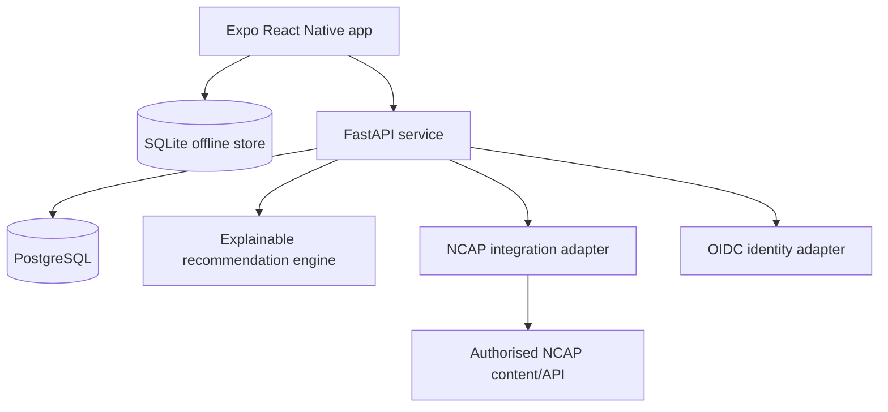

# Khetha AI Platform

Mobile-first, offline-capable career guidance companion for the GovTech 2026 DHET challenge.

The repository is structured as a production-oriented monorepo while keeping the first hackathon journey small enough to finish: learner subjects and interests → explainable career suggestions → saved journey → reminder or career-practitioner hand-off.

## Architecture



## Repository

```text
khetha-ai-platform/
├── apps/mobile/                 Expo SDK 57 + React Native + TypeScript
├── services/api/                FastAPI + SQLAlchemy 2
├── database/migrations/         PostgreSQL schema
├── database/seed/               Clearly labelled demo catalogue
├── docs/                        Architecture, data and delivery decisions
├── .github/workflows/           Pull-request and main-branch CI
├── docker-compose.yml           PostgreSQL and API services
└── .env.example                 Non-secret configuration contract
```

## Quick start

### 1. API and database with Docker

```bash
cp .env.example .env
docker compose up --build
```

API documentation: `http://localhost:8000/docs`

### 2. Mobile app

```bash
cd apps/mobile
cp .env.example .env
npm ci
npm run start
```

Android emulator API URL: `http://10.0.2.2:8000`.

Physical phone API URL: use the development computer's LAN IP, for example `http://192.168.1.20:8000`.

On Windows PowerShell, replace each `cp .env.example .env` command with:

```powershell
Copy-Item .env.example .env
```

## Demo identity

Development requests use the seeded header:

```text
X-Demo-User-ID: 00000000-0000-4000-8000-000000000001
```

Production must use an approved OIDC provider. The demo header is rejected when `APP_ENV` is not `development` or `test`.

## Safety boundary

The included catalogue is demonstration data, not official DHET or NCAP guidance. Every record is labelled accordingly. Replace it through the NCAP adapter before a pilot. Generative AI may later explain approved fields, but it must never invent careers, qualifications, providers, admission criteria or eligibility decisions.

## Main commands

```bash
# Backend tests
cd services/api
python -m venv .venv
source .venv/bin/activate
pip install -r requirements-dev.txt
PYTHONPATH=. pytest

# Mobile checks
cd apps/mobile
npm ci
npm run typecheck
npx expo export --platform android --output-dir dist
```

See [docs/architecture.md](docs/architecture.md), [docs/database.md](docs/database.md), [docs/api.md](docs/api.md), [docs/github-setup.md](docs/github-setup.md) and [docs/hackathon-plan.md](docs/hackathon-plan.md).
